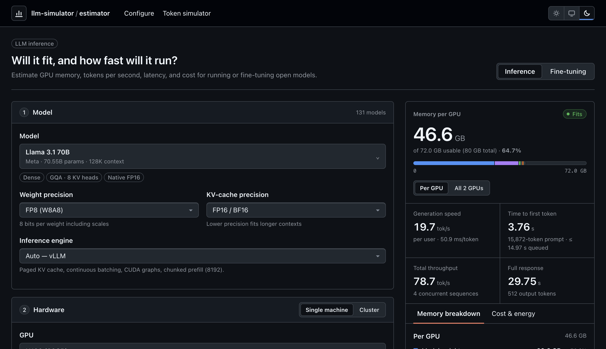

# LLM Simulator

**[Try LLM Simulator →](https://omarbaker8.github.io/llm-simulator/)**

Static web app for estimating GPU memory, throughput, latency, energy, and cloud cost for LLM inference, fine-tuning (Full / LoRA / QLoRA), and image/video diffusion.

[](https://omarbaker8.github.io/llm-simulator/)

## Usage

Open `index.html` directly in a browser or serve the directory with any static file server (zero build step, zero runtime dependencies).

## Tests

```bash
node tests/verify.js     # formulas, physics bounds, monotonicity, benchmark ranges, dataset checks
node tests/hand.js       # 72 hand-calculated values from published model configs
node tests/scenarios.js  # 227 scenario tests: memory, KV, FLOPs, runtimes, parallelism, fine-tuning, diffusion, benchmarks
node tests/llmservingsim/compare.js  # LLMServingSim scenarios + real vLLM runs replayed through this calculator
node tests/real-data/compare.js      # ~6,000 real measurements (llama.cpp scoreboards, InferenceX logs, Argonne, torchtitan, diffusers); see tests/real-data/RESULTS.md
```


